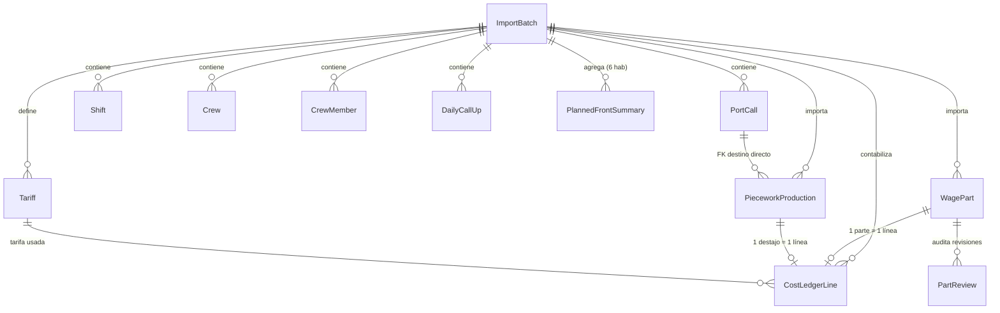

# Modelo de Datos y Garantías · Reto 1 (Puerto Delta)

> **Estado de integración con equipo:** Preparado para conciliar con el modelo relacional de las compañeras. Todas las entidades requeridas por la arquitectura (`ImportBatch`, `PortCall`, `Shift`, `Crew`, `CrewMember`, `DailyCallUp`, `PlannedFrontSummary`, `Tariff`, `WagePart`, `PieceworkProduction`, `CostLedgerLine`, `PartReview`) están representadas con integridad referencial e invariantes de negocio.

## Diagrama Entidad-Relación

## Entidades e Invariantes

### 1. `ImportBatch` (Lote de importación)
- `id`: PK.
- `sha256`: huella SHA-256 canónica sobre el conjunto ordenado de los 7 archivos CSV (`unique=True`).
- `source_rows`: total de filas de datos importadas (`343` en el lote oficial).
- `is_active`: booleano; solo un lote puede estar activo para lecturas y exportes del período.
- `results_version`: contador entero que se incrementa atómicamente en cada revisión validada.
- `file_hashes`: JSON con hash y conteo de filas por cada uno de los 7 CSV.
- `imported_by`, `imported_at`.

### 2. Catálogos por lote (`PortCall`, `Shift`, `Crew`, `CrewMember`, `Tariff`)
- **`PortCall` (`recaladas.csv`):** `call_id` (`REC-2051`, `REC-2052`, `REC-2053`), `nave`, `tipo_carga`, `cliente`, `muelle`, `atraque`, `desatraque`, `source_file`, `row_number`. Unique `(batch, call_id)` y `(batch, source_file, row_number)`.
- **`Shift` (`turnos.csv`):** `code` (`A`, `B`, `C`), `hora_inicio`, `hora_fin` (`24:00` normalizado a `00:00` del día siguiente con `spans_next_day=True`).
- **`Crew` y `CrewMember` (`cuadrillas.csv`):** 15 cuadrillas fijas (`CU-01`..`CU-15`) de 6 trabajadores (`T-001`..`T-090`). Cada trabajador pertenece a una sola cuadrilla por lote.
- **`Tariff` (`tarifario.csv`):** `modalidad` (`Jornal` / `Destajo`), `concepto`, `unidad`, `tarifa_usd` (`Decimal(10, 2)`).

### 3. Planificación (`DailyCallUp` y `PlannedFrontSummary`)
- **`DailyCallUp` (`nombrada_diaria.csv`, 186 filas):** registro granular por trabajador (`fecha`, `turno`, `cuadrilla`, `id_trabajador`, `frente_asignado`, `row_number`).
- **`PlannedFrontSummary` (31 contextos):** agregación previa de los 6 integrantes por `(batch, fecha, turno, cuadrilla)` con la lista de frentes únicos asignados (`frentes`) y las referencias de fila (`nombrada_refs`). Evita multiplicar partes al cruzar con `WagePart` (Regla R2/R6).

### 4. Hechos Operativos (`WagePart` y `PieceworkProduction`)
- **`WagePart` (`partes_jornal.csv`, 35 filas):**
  - Procedencia: `source_file='partes_jornal.csv'`, `row_number` (línea física CSV con cabecera, p. ej. `2..36`), `UniqueConstraint(batch, source_file, row_number)`.
  - Datos originales intactos: `fecha`, `turno`, `cuadrilla`, `tarea`, `personas`, `jornales` (`Decimal(8, 2)`), `supervisor` (firmante histórico, **nunca** inferido como validador R12), `observacion`.
  - Decisión y atribución: `status` (`confirmado`, `validado`, `sugerido`, `pendiente`), `destination` (`REC-2051`..`REC-2053`, `REC-SSGG` o `NULL`), `suggested_destination`, `strength` (`fuerte`/`debil`/`NULL`), `rule_code`, `rule_version`, `reason`, `candidates` (JSON), `evidence` (JSON con turno, observación, frente, destajo del contexto y solape de ventanas), `alerts` (JSON).
  - Control de concurrencia y validación: `version` (entero incrementado en cada revisión), `active_review` (FK nullable a `PartReview` que acredita la validación vigente; si cambia el destino se reemplaza para no heredar una aprobación anterior).
- **`PieceworkProduction` (`produccion_destajo.csv`, 20 filas):**
  - Procedencia: `source_file='produccion_destajo.csv'`, `row_number` (`2..21`), `UniqueConstraint(batch, source_file, row_number)`.
  - FK directa a `PortCall` (`port_call`) + `call_id`, `fecha`, `turno`, `cuadrilla`, `concepto` (`tipo_carga_destajo`), `personas`, `toneladas` (`Decimal(12, 3)`).

### 5. Libro Monetario (`CostLedgerLine`, 55 filas)
- Cada línea enlaza **exactamente** un `WagePart` o un `PieceworkProduction` (`CheckConstraint`: uno y solo uno no nulo; `OneToOneField` a cada origen).
- Guarda `tariff` (FK a `Tariff`), `modalidad`, `quantity` (`Decimal(12, 3)`), `unit_rate_usd` (`Decimal(10, 2)`), `amount_usd` (`Decimal(12, 2)` redondeado con `ROUND_HALF_UP` por línea según R10).
- Invariante del lote oficial: 35 líneas de jornal (`USD 9.594,58`) + 20 líneas de destajo (`USD 13.563,66`) = **55 referencias únicas y `USD 23.158,24`**.

### 6. Auditoría y Concurrencia (`PartReview`)
- `wage_part` (FK), `operation_id` (`UUIDField(unique=True)`), `payload_hash` (SHA-256 de `{part_id, destination, reason, reference, expected_version}`).
- `actor` (FK a `User` autenticado en sesión), `actor_username`, `created_at`.
- `from_status`, `to_status`, `from_destination`, `to_destination`, `reason`, `reference`, `version_before`, `version_after`, `amount_usd_snapshot`.
- Bloqueo pesimista (`select_for_update()`) al revisar, idempotencia por `operation_id` + `payload_hash` y rechazo `409 Conflict` ante versión vencida o reutilización de `operation_id` con distinto contenido.
